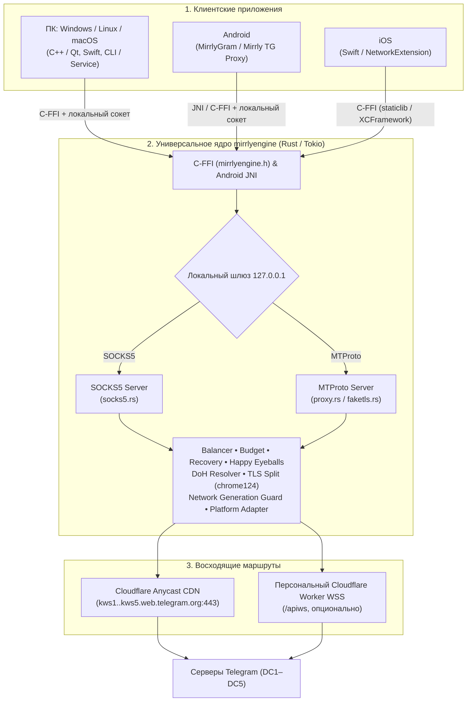

<div align="center">


# mirrlyengine

**Универсальное нативное прокси-ядро на Rust (`Tokio`, `rustls`, `ring`) для `Windows`, `Linux`, `macOS`, `iOS` и `Android` с поддержкой `SOCKS5`, `MTProto FakeTLS`, Anycast CDN ([Flowseal](https://github.com/Flowseal)) и Cloudflare Worker `WSS`**

<br/>

[](src/lib.rs)
[](#2-поддерживаемые-платформы)
[](#2-поддерживаемые-платформы)
[](#2-поддерживаемые-платформы)
[](#2-поддерживаемые-платформы)
[](#2-поддерживаемые-платформы)
<br/>
[](#3-технический-принцип-работы)
[](#3-технический-принцип-работы)
[](#4-архитектура-системы)
[](#5-c-ffi-и-jni-интерфейс)
<br/>
[](https://t.me/WhyOKyHb)
[](https://github.com/joycecurcirt539-dot/MirrlyGram)
[](https://github.com/joycecurcirt539-dot/Mirrly-TG-Proxy)
[](LICENSE)

*Автономное сетевое ядро маршрутизации трафика Telegram без системного VPN. Обеспечивает локальные шлюзы `SOCKS5` и `MTProto`, пул постоянных WebSocket-подключений через Cloudflare Anycast CDN и собственные домены Cloudflare Worker, обход DPI-фильтрации и быстрое восстановление при смене сети.*

---

<h3>Поддержать разработку</h3>

Проекты экосистемы Mirrly распространяются бесплатно и с открытым исходным кодом. Поддержать дальнейшее развитие ядра и клиентов можно банковской картой, через СБП, Mir Pay или Яндекс Пэй:

<br/>

[](https://pay.cloudtips.ru/p/e8c24aee)
&nbsp;
[](https://tips.yandex.ru/guest/payment/3754149)
&nbsp;
[](https://dalink.to/cartneyzix)

---

</div>

## Оглавление

1. [Что такое mirrlyengine](#1-что-такое-mirrlyengine)
2. [Поддерживаемые платформы](#2-поддерживаемые-платформы)
3. [Технический принцип работы](#3-технический-принцип-работы)
4. [Архитектура системы](#4-архитектура-системы)
5. [C-FFI и JNI-интерфейс](#5-c-ffi-и-jni-интерфейс)
6. [Структура проекта и сборка из исходного кода](#6-структура-проекта-и-сборка-из-исходного-кода)
7. [Безопасность, приватность и лицензия](#7-безопасность-приватность-и-лицензия)
8. [Экосистема и ссылки](#8-экосистема-и-ссылки)

---

## 1. Что такое mirrlyengine

**`mirrlyengine`** — единое кроссплатформенное прокси-ядро на Rust (`Tokio` + `rustls` + `ring`) для клиентских приложений и системных служб экосистемы Mirrly на **Windows**, **Linux**, **macOS**, **iOS** и **Android**.

Библиотека встраивается напрямую в процесс приложения (через [include/mirrlyengine.h](include/mirrlyengine.h) по `C-FFI`, через `JNI` на Android или как Rust-крейт `rlib`), поднимая локальные шлюзы на `127.0.0.1` (включая эфемерный порт `0`) без необходимости получать root-права.

### Ключевые возможности
* **Два локальных шлюза**:
  * **SOCKS5** (`RFC 1928` / `RFC 1929`): асинхронный TCP-релей с опциональным оптимистичным ранним ответом (`SetSocks5Optimistic`), выбором режима исходящего транспорта и сопоставлением адресов дата-центров Telegram (`DC1`–`DC5`, включая медиа-узлы и IPv6).
  * **MTProto** (`Obfuscated2` / `FakeTLS`): локальный шлюз с поддержкой секретов `dd`/`ee`, разбором целевого дата-центра, разделением больших медиа-фреймов и тёплым пулом WebSocket-подключений (`WsPool`).
* **Транспорт и обход фильтрации**:
  * Маршрутизация через встроенный пул Cloudflare Anycast CDN ([Flowseal](https://github.com/Flowseal)) или персональный домен Cloudflare Worker `WSS` (`/apiws`).
  * Внешняя обёртка `TLS 1.2/1.3`, фрагментация `ClientHello`, padding TLS-записей и профиль отпечатка `chrome124`.
  * Гонка подключений по `Happy Eyeballs` (RFC 8305), встроенный `DoH`-резолвер, квотирование установок соединений (`budget.rs`) и независимость узлов (`node_independence.rs`).
* **Устойчивость при смене сети**:
  * Изоляция поколений сети (`generation_guard.rs`): мгновенная отмена зависших попыток при переключении `Wi-Fi <-> LTE` или смене интерфейса.
  * Скоринговый балансировщик по дата-центрам (`balancer.rs`), эскалация восстановления (`recovery.rs`) и сброс сокетов при пробуждении устройства.

---

## 2. Поддерживаемые платформы

Ядро собирается в виде динамической, статической или Rust-библиотеки (`crate-type = ["cdylib", "staticlib", "rlib"]`) без внешних C-зависимостей для TLS (`rustls` + `ring` + `webpki-roots`):

| Платформа | Статус | Целевой формат | Интерфейс | Целевые таргеты Rust |
| :--- | :--- | :--- | :--- | :--- |
| **Windows** | Поддерживается | `.dll` / `.dll.lib` / `.lib` / `.rlib` | `C-FFI` ([mirrlyengine.h](include/mirrlyengine.h)) | `x86_64-pc-windows-msvc`, `aarch64-pc-windows-msvc` |
| **Linux** | Поддерживается | `.so` / `.a` / `.rlib` | `C-FFI` ([mirrlyengine.h](include/mirrlyengine.h)) | `x86_64-unknown-linux-gnu`, `aarch64-unknown-linux-gnu` |
| **macOS** | Поддерживается | `.dylib` / `.a` / `.rlib` | `C-FFI` (`Swift` / `Obj-C` / `C++`) | `aarch64-apple-darwin`, `x86_64-apple-darwin` |
| **iOS** | Поддерживается | `.a` / `XCFramework` (`staticlib`) | `C-FFI` ([module.modulemap](include/module.modulemap)) | `aarch64-apple-ios`, `aarch64-apple-ios-sim`, `x86_64-apple-ios` |
| **Android** | Поддерживается | `libmirrlyengine.so` (`cdylib`) | `JNI` + `C-FFI` | `aarch64-linux-android`, `armv7-linux-androideabi`, `x86_64-linux-android` |

> * Для 64-битных целей Android в [.cargo/config.toml](.cargo/config.toml) включены `-Wl,-z,max-page-size=16384` и `--build-id=sha1`.
> * На `macOS` и `iOS` сокеты автоматически защищаются от `SIGPIPE` (`SO_NOSIGPIPE`), чтобы встроенный `staticlib`/`dylib` не завершал хост-приложение при разрыве соединения.
> * Принудительный `TCP_MAXSEG = 1240` применяется только при активном мобильном/лимитируемом профиле сети и не режет широкополосные десктопные каналы.

---

## 3. Технический принцип работы

### Маршрут 1: Локальный SOCKS5 (`socks5.rs`)
1. Клиент (на ПК или Android) подключается к локальному слушателю `SOCKS5` на `127.0.0.1` (при необходимости с логином/паролем через `SetSocks5Auth`).
2. `mirrlyengine` определяет целевой дата-центр Telegram (`DC1`–`DC5`), переводит IPv6/алиасы к каноническому IPv4-адресу с сохранением явных медиа-IP и при включённом `SetSocks5Optimistic` подтверждает соединение без ожидания полного сетевого RTT.
3. Данные передаются в выбранный восходящий канал (`cfproxy.rs`, `ws.rs`) через тёплый пул соединений и балансировщик.

### Маршрут 2: Локальный MTProto (`proxy.rs`, `faketls.rs`)
1. Клиент подключается к локальному порту `MTProto` с секретом формата `dd...` (без внешнего TLS) или `ee...` (с внешней обёрткой TLS).
2. Шлюз расшифровывает 64-байтный заголовок `Obfuscated2`, извлекает `DC` (и признак медиа-трафика) и берёт готовое WebSocket-соединение из `WsPool`.
3. При обрыве сети или смене поколения `generation_guard.rs` закрывает устаревшие сокеты, а `recovery.rs` и `balancer.rs` переключают маршрут на следующий рабочий домен.

---

## 4. Архитектура системы



---

## 5. C-FFI и JNI-интерфейс

Все публичные функции объявлены в едином заголовке [include/mirrlyengine.h](include/mirrlyengine.h) (и [include/module.modulemap](include/module.modulemap) для Swift / Xcode) и экспортируются с `#[no_mangle]` в [src/lib.rs](src/lib.rs). Строки, возвращаемые в `*mut c_char`, освобождаются на стороне вызывающего кода через `FreeString`.

| Категория | Ключевые функции `C-FFI` | Назначение |
| :--- | :--- | :--- |
| **Жизненный цикл и порты** | `StartProxy`, `StartSocks5Proxy`, `GetMtprotoListenPort`, `GetSocks5ListenPort`, `StopProxy`, `StopMtprotoProxy`, `StopSocks5Proxy` | Запуск (включая `port = 0`), чтение выданного порта и остановка локальных серверов |
| **Рантайм и логи** | `SetRuntimeWorkerThreads`, `SetLogCallback` | Лимит потоков Tokio (например, для iOS `NetworkExtension`) и перехват логов в GUI/клиенте |
| **Сеть и сокеты** | `ResetNetworkSockets`, `EmergencyKillAllSockets`, `SuspendNetworkSockets`, `WarmupWsPool`, `OnScreenWakeup` | Сброс зависших сокетов, прогрев `WsPool`, реакции на сон/пробуждение |
| **Профиль и пул** | `SetNetworkProfile`, `SetNetworkProfileJson`, `SetNetworkGeneration`, `SetPoolSize`, `SetMtprotoStandbyPerActiveSlot`, `SetSocketBufferSizes`, `SetMaxSocketBufferCeiling` | Переключение профиля, смена поколения сети, тюнинг буферов (до 8 МБ) и пула |
| **TLS и SOCKS5** | `SetTlsEnabled`, `SetTlsClientHelloSplitEnabled`, `SetTlsRecordPaddingEnabled`, `SetSocks5Auth`, `SetSocks5Optimistic`, `SetSocks5UplinkMode` | Управление внешним TLS, фрагментацией, авторизацией и режимом SOCKS5 |
| **Anycast / Worker** | `SetCfProxyConfig`, `PromoteCfproxyDomainForDc`, `SetSecret` | Настройка домена Cloudflare Worker, продвижение CDN-домена, смена секрета |
| **Телеметрия** | `GetStatsJson`, `GetTransportPoolStatusJson`, `GetDomainBalancerStatusJson`, `GetDialBudgetStatsJson`, `GetTlsObservabilityStatusJson`, `FreeString` | Снятие JSON-метрик состояния ядра и освобождение C-строк |

Для Android (а также при сборке с `--features jni`) дополнительно компилируются нативные методы `Java_org_telegram_messenger_mirrly_MirrlyEngineController_*`; в десктопных и iOS-артефактах они не экспортируются.

---

## 6. Структура проекта и сборка из исходного кода

### Дерево каталогов

```text
mirrlyengine/
├── .cargo/
│   └── config.toml                # Флаги линковки Android (16 KB alignment + build-id)
├── .github/
│   └── workflows/ci.yml           # Кросс-платформенный CI (Windows, Linux, macOS, iOS, Android)
├── docs/
│   └── assets/
│       └── logo.png               # Логотип проекта для README
├── include/
│   ├── mirrlyengine.h             # Заголовок C / C++ / Swift для C-FFI
│   └── module.modulemap           # Описание модуля Apple для XCFramework
├── src/
│   ├── balancer.rs                # Балансировка доменов по дата-центрам и поколениям сети
│   ├── bridge.rs                  # Мост двунаправленной передачи потоков и дренаж
│   ├── budget.rs                  # Бюджет установок соединений и DNS Singleflight
│   ├── cfproxy.rs                 # Cloudflare Anycast CDN, DoH и Happy Eyeballs (RFC 8305)
│   ├── config.rs                  # Параметры конфигурации и адаптивные лимиты
│   ├── crypto.rs                  # Криптография Obfuscated2 и потоковый сплиттер
│   ├── faketls.rs                 # FakeTLS маскировка и разбор фреймов
│   ├── generation_guard.rs        # Защита от гонок при смене поколений сети
│   ├── lib.rs                     # Точка входа C-FFI, Tokio runtime и опциональный JNI-мост
│   ├── network_profile.rs         # Профили сети и метрики SLI
│   ├── node_independence.rs       # Оценка независимости узлов и колокаций
│   ├── platform.rs                # Платформенный слой (логи, сокеты, дефолты для 5 ОС)
│   ├── proxy.rs                   # Локальный MTProto-шлюз и пул WebSocket
│   ├── recovery.rs                # Эскалация восстановления и карантин маршрутов
│   ├── socks5.rs                  # Локальный SOCKS5-сервер (RFC 1928 / RFC 1929)
│   ├── tls_observability.rs       # Телеметрия TLS-хэндшейков
│   └── ws.rs                      # WebSocket-транспорт и фрагментация ClientHello
├── tests/                         # Интеграционные и контрактные тесты
├── Cargo.toml                     # Манифест крейта (edition = "2021", cdylib + staticlib + rlib)
├── Cargo.lock                     # Зафиксированные версии зависимостей
├── LICENSE                        # GNU GPLv3
└── README.md
```

### Системные требования

* **Rust Toolchain**: `rustc` / `cargo` (MSRV под `edition = "2021"`, проверено на `1.97.1`)
* **Windows**: Visual Studio / Build Tools C++ (`MSVC x64`, запуск из среды `vcvars64.bat` или `Developer Command Prompt`)
* **Linux**: стандартный тулчейн `gcc` / `clang` и `libc-dev`
* **macOS / iOS**: Xcode + Command Line Tools, таргеты `aarch64-apple-darwin`, `x86_64-apple-darwin`, `aarch64-apple-ios`, `aarch64-apple-ios-sim`
* **Android**: `cargo-ndk` + Android NDK и таргеты `aarch64-linux-android`, `armv7-linux-androideabi`, `x86_64-linux-android`

### Команды сборки и тестирования

```bash
# Модульные и интеграционные тесты на текущей платформе
cargo test

# Сборка релизной библиотеки под ПК (Windows .dll/.lib, Linux .so/.a, macOS .dylib/.a)
cargo build --release

# Сборка XCFramework для iOS (на macOS)
cargo build --release --target aarch64-apple-ios
cargo build --release --target aarch64-apple-ios-sim
xcodebuild -create-xcframework \
  -library target/aarch64-apple-ios/release/libmirrlyengine.a -headers include \
  -library target/aarch64-apple-ios-sim/release/libmirrlyengine.a -headers include \
  -output target/MirrlyEngine.xcframework

# Сборка под Android (запускать из корня репозитория, чтобы применялся .cargo/config.toml)
cargo ndk -t arm64-v8a -t armeabi-v7a --platform 23 build --release
```

---

## 7. Безопасность, приватность и лицензия

* **Локальная работа**: ядро обрабатывает трафик локально на устройстве и не отправляет стороннюю телеметрию на внешние серверы.
* **Открытый и переносимый код**: ядро не содержит платформенно-завязанных проверок подписи или скрытых блокировок и работает единообразно на десктопах и мобильных устройствах.
* **Лицензия**: проект распространяется на условиях `GNU General Public License v3` (см. [LICENSE](LICENSE)).

---

## 8. Экосистема и ссылки

* **[MirrlyGram](https://github.com/joycecurcirt539-dot/MirrlyGram)**: модифицированный клиент Telegram для Android со встроенным `mirrlyengine`.
* **[Mirrly TG Proxy](https://github.com/joycecurcirt539-dot/Mirrly-TG-Proxy)**: автономный локальный прокси и системный VPN-клиент экосистемы Mirrly.
* **[Flowseal](https://github.com/Flowseal)**: автор концепции маршрутизации трафика Telegram через Anycast CDN и WebSocket-сессии Cloudflare (`tg-ws-proxy`).
* **Официальный Telegram-канал**: [@WhyOKyHb](https://t.me/WhyOKyHb) (новости разработки и релизы).
