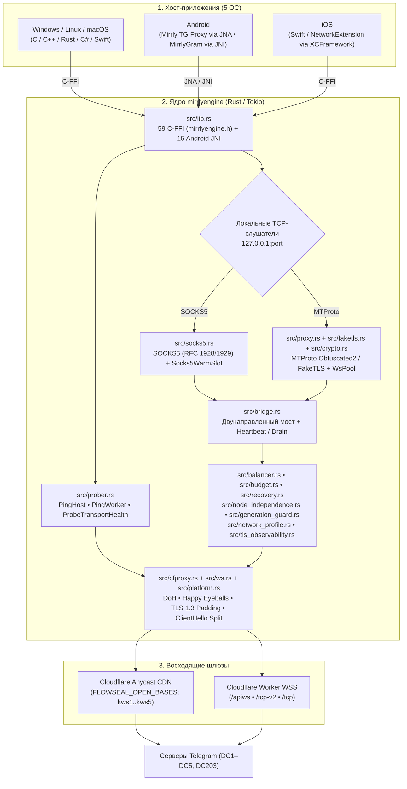

<div align="center">


# mirrlyengine

**Кроссплатформенное нативное прокси-ядро на Rust (`Tokio`, `rustls`, `ring`) для `Windows`, `Linux`, `macOS`, `iOS` и `Android` с поддержкой `SOCKS5`, `MTProto FakeTLS`, Anycast CDN ([Flowseal](https://github.com/Flowseal)) и Cloudflare Worker `WSS`**

<br/>

[](src/lib.rs)
[](#2-поддерживаемые-платформы-и-форматы-поставки)
[](#2-поддерживаемые-платформы-и-форматы-поставки)
[](#2-поддерживаемые-платформы-и-форматы-поставки)
[](#2-поддерживаемые-платформы-и-форматы-поставки)
[](#2-поддерживаемые-платформы-и-форматы-поставки)
<br/>
[](#3-протоколы-и-обработка-трафика)
[](#3-протоколы-и-обработка-трафика)
[](#4-архитектура-и-модули-ядра)
[](#5-справочник-c-ffi-и-jni-интерфейса)
<br/>
[](https://t.me/WhyOKyHb)
[](https://github.com/joycecurcirt539-dot/MirrlyGram)
[](https://github.com/joycecurcirt539-dot/Mirrly-TG-Proxy)
[](LICENSE)

*Единое сетевое ядро маршрутизации трафика Telegram без системного VPN. Поднимает локальные шлюзы `SOCKS5` и `MTProto`, управляет тёплыми пулами WebSocket-сессий через Cloudflare Anycast CDN и пользовательские домены Cloudflare Worker, выполняет DPI-устойчивую фрагментацию и padding TLS-записей и предоставляет встроенную сетевую диагностику.*

---

<h3>Поддержать разработку</h3>

Проекты экосистемы Mirrly распространяются бесплатно и с открытым исходным кодом. Поддержать дальнейшее развитие ядра и клиентов можно банковской картой, через СБП, Mir Pay или Яндекс Пэй:

<br/>

[](https://pay.cloudtips.ru/p/e8c24aee)
&nbsp;
[](https://tips.yandex.ru/guest/payment/3754149)
&nbsp;
[](https://dalink.to/cartneyzix)

---

</div>

## Оглавление

1. [Назначение и роль репозитория](#1-назначение-и-роль-репозитория)
2. [Поддерживаемые платформы и форматы поставки](#2-поддерживаемые-платформы-и-форматы-поставки)
3. [Протоколы и обработка трафика](#3-протоколы-и-обработка-трафика)
4. [Архитектура и модули ядра](#4-архитектура-и-модули-ядра)
5. [Справочник C-FFI и JNI-интерфейса](#5-справочник-c-ffi-и-jni-интерфейса)
6. [Структура репозитория, сборка и тестирование](#6-структура-репозитория-сборка-и-тестирование)
7. [Безопасность, приватность и лицензия](#7-безопасность-приватность-и-лицензия)
8. [Экосистема и ссылки](#8-экосистема-и-ссылки)

---

## 1. Назначение и роль репозитория

**`mirrlyengine`** — единый канонический репозиторий нативного прокси-движка экосистемы Mirrly на базе `Tokio`, `rustls 0.23` и `ring 0.17`.

Клиентские приложения (`Mirrly TG Proxy`, `MirrlyGram`, десктопные и iOS/macOS-клиенты) не хранят у себя локальные копии исходного кода движка, а подключают скомпилированные из этого репозитория бинарные артефакты (`libmirrlyengine.so`, `mirrlyengine.dll`, `libmirrlyengine.dylib`, `libmirrlyengine.a`, `MirrlyEngine.xcframework`) через единый C-заголовок [include/mirrlyengine.h](include/mirrlyengine.h) или JNI-мост `MirrlyEngineController`.

### Что делает движок
* **Два независимых локальных шлюза (`127.0.0.1`, включая эфемерный порт `0`)**:
  * **`SOCKS5` (`RFC 1928` / `RFC 1929`)**: аутентификация с проверкой учётных данных за константное время (SHA-256), распознавание IPv4/IPv6-подсетей Telegram (`DC1`–`DC5`, `DC203`, медиа-узлы), управляемый оптимистичный ответ (`SetSocks5Optimistic`), тёплый пул `Socks5WarmSlot` и прямая L4-передача для не-Telegram хостов через `/tcp` и `/tcp-v2`.
  * **`MTProto` (`Obfuscated2` + `FakeTLS`)**: приём секретов `dd<32_hex>` и `ee<32_hex><domain_hex>`, проверка клиентского `FakeTLS ClientHello` (HMAC-SHA256 + защита от повторов по времени), демультиплексирование по дата-центрам и медиа-потокам, нарезка пакетов через `MsgSplitter` и шардированный тёплый пул `WsPool`.
* **Устойчивый восходящий транспорт и обход ТСПУ/DPI**:
  * Два режима аплинка: распределённый пул Cloudflare Anycast CDN ([Flowseal](https://github.com/Flowseal) `kws1..kws5`) и пользовательский Cloudflare Worker `WSS` (`/apiws`).
  * Управляемая фрагментация `ClientHello` на уровне записей TLS `0x16` и TCP-сегментов (`TlsClientHelloSplitStream`), RFC 8446 `TLSInnerPlaintext` AEAD record padding в TLS 1.3 (`PaddedTls13AeadAlgorithm`, флаг `SetTlsRecordPaddingEnabled`), браузерные профили шифров и ALPN (`chrome`, `firefox`, `safari`) и отдельный чистый профиль `TLS_CONFIG_RELAY` для `/tcp`-релея.
  * Dual-stack `DoH`-резолвер с `Singleflight`-дедупликацией, гонка подключений `Happy Eyeballs` (RFC 8305) с чередованием IPv6/IPv4, диверсификация кандидатов по `ASN` / префиксам `/24` и `/48` / колокациям `CF-RAY` (`node_independence.rs`) и карантин доменов при `HTTP 429`.
* **Адаптация к сети и встроенная диагностика**:
  * Многомерный профиль сети (`NetworkProfile`: тип транспорта, `MTU`, энергосбережение, политика `IPV4_ONLY` / `IPV6_ONLY` / `DUAL_STACK` / `IPV6_PREFERRED`, задержка `Happy Eyeballs`, интервал WebSocket keep-alive `15..=120` с).
  * Защита от гонок при смене сети (`generation_guard.rs`), ступенчатое восстановление (`recovery.rs`), пер-DC балансировщик (`balancer.rs`) без утечки скоринга `DC2` на другие дата-центры, динамический потолок сокет-буферов ОС до `8 МиБ` (`SetMaxSocketBufferCeiling`), управляемый `TCP_NODELAY` (`SetTcpNoDelay`, по умолчанию `false`) и колбэк защиты дескрипторов `SetProtectSocketCallback` (`VpnService.protect(fd)`).
  * Нативные неблокирующие проберы (`prober.rs`): `PingHost`, `PingWorker` (классификация `ONLINE`, `RATE_LIMITED_429`, `OFFLINE`) и `ProbeTransportHealth` (режимы `0..=3`).

---

## 2. Поддерживаемые платформы и форматы поставки

Крейт собирается как `cdylib`, `staticlib` и `rlib` без зависимости от OpenSSL (`rustls` + `ring` + `webpki-roots`):

| Платформа | Артефакты сборки | ABI / Интерфейс | Целевые триплеты Rust |
| :--- | :--- | :--- | :--- |
| **Windows** | `mirrlyengine.dll`, `mirrlyengine.dll.lib`, `mirrlyengine.lib`, `.rlib` | `C-FFI` ([mirrlyengine.h](include/mirrlyengine.h)) | `x86_64-pc-windows-msvc`, `aarch64-pc-windows-msvc` |
| **Linux** | `libmirrlyengine.so`, `libmirrlyengine.a`, `.rlib` | `C-FFI` ([mirrlyengine.h](include/mirrlyengine.h)) | `x86_64-unknown-linux-gnu`, `aarch64-unknown-linux-gnu` |
| **macOS** | `libmirrlyengine.dylib`, `libmirrlyengine.a`, `.rlib` | `C-FFI` (`C` / `C++` / `Swift` / `Obj-C`) | `aarch64-apple-darwin`, `x86_64-apple-darwin` |
| **iOS** | `libmirrlyengine.a`, `MirrlyEngine.xcframework` | `C-FFI` ([module.modulemap](include/module.modulemap)) | `aarch64-apple-ios`, `aarch64-apple-ios-sim`, `x86_64-apple-ios` |
| **Android** | `libmirrlyengine.so` (выравнивание `LOAD` `0x4000` / `16 KiB`) | `C-FFI` (JNA / NDK) + `15` методов `JNI` | `aarch64-linux-android`, `armv7-linux-androideabi`, `i686-linux-android`, `x86_64-linux-android` |

Особенности платформенного слоя ([src/platform.rs](src/platform.rs)):
* **Android 15+ (`16 KiB` page size)**: в [.cargo/config.toml](.cargo/config.toml) для `aarch64-linux-android` и `x86_64-linux-android` заданы флаги `-Wl,-z,max-page-size=16384` и `-Wl,--build-id=sha1`.
* **macOS и iOS**: на всех создаваемых сокетах выставляется `SO_NOSIGPIPE`, предотвращающий аварийное завершение хост-приложения сигналом `SIGPIPE` при записи в закрытый пиром сокет.
* **Мобильный `TCP_MAXSEG`**: ограничение `TCP_MAXSEG = 1240` активируется только на `CELLULAR`/`VPN` или тарифицируемых мобильных сетях и никогда не применяется к локальным loopback-соединениям (`127.0.0.1` / `::1`) и широкополосным десктопным каналам.
* **Логирование без `stderr`**: помимо `stderr` (на не-Android) и Android `logcat`, поддерживается хост-колбэк `SetLogCallback` для вывода логов в GUI-приложениях на Windows, macOS и iOS.

---

## 3. Протоколы и обработка трафика

### 3.1. Локальный шлюз `SOCKS5` ([src/socks5.rs](src/socks5.rs))
1. **Рукопожатие и авторизация**: поддержка `0x00` (без авторизации) и `0x02` (`RFC 1929` Username/Password с хэшированием `SHA-256` и сравнением за константное время).
2. **Маршрутизация дата-центров Telegram**:
   * Автоматическое определение принадлежности IPv4/IPv6-адреса к Telegram (`149.154.160.0/20`, `91.108.4.0/22`, `91.108.8.0/22`, `91.108.12.0/22`, `91.108.16.0/22`, `91.108.20.0/22`, `91.108.56.0/22`, `91.105.192.0/23`, `185.76.151.0/24`, `2001:b28:f23d::/48`, `2001:b28:f23f::/48`, `2001:67c:4e8::/48`).
   * Каноническая нормализация IPv6-адресов Telegram в целевые IPv4-адреса дата-центров с сохранением явных медиа-узлов (например, `149.154.167.118`, `149.154.167.93` для `DC4 media`).
3. **Управляемый оптимистичный ответ (`SetSocks5Optimistic`)**:
   * При `SOCKS5_OPTIMISTIC_RESPONSE == true` (по умолчанию): прокси сразу отправляет `0x05, 0x00`, коалесцирует 64-байтный заголовок `Obfuscated2` и приклеенный первый RPC-пакет из буфера ядра, извлекает `DC` и медиа-флаг и поднимает WebSocket-туннель.
   * При `SOCKS5_OPTIMISTIC_RESPONSE == false`: прокси сначала получает живой восходящий WebSocket из `Socks5WarmSlot` или устанавливает новое соединение; при отказе аплинка возвращает клиенту `0x05, 0x05` (Connection refused), а при успехе отправляет `0x05, 0x00`, читает 64-байтный `init`, патчит `DC` для Flowseal и запускает двунаправленный мост `bridge_socks5_ws`.
4. **Сторонние TCP-хосты**: если адрес назначения не принадлежит Telegram и настроен личный Worker, трафик туннелируется через `/tcp-v2` (с автоматическим откатом на `/tcp`) поверх стандартного `TLS_CONFIG_RELAY`. Прямой незащищённый TCP-фоллбэк к IP-адресам Telegram заблокирован во избежание 10-секундных зависаний на ТСПУ.

### 3.2. Локальный шлюз `MTProto` ([src/proxy.rs](src/proxy.rs), [src/faketls.rs](src/faketls.rs))
1. **Секреты и `GetSecretWithPrefix()`**:
   * `StartProxy` и `SetSecret` принимают чистый 32-символьный hex, `dd<32_hex>` или `ee<32_hex><domain_hex>`. При передаче `ee`-секрета с валидным hex-доменом домен сохраняется в `FAKETLS_DOMAIN` (по умолчанию `www.google.com` = `7777772e676f6f676c652e636f6d`).
   * `GetSecretWithPrefix()` динамически проверяет `IsTlsEnabled()`: при `IsTlsEnabled() == 1` возвращает `ee{32_hex}{domain_hex}`, при `0` — `dd{32_hex}`.
2. **Обработка `FakeTLS` и `Obfuscated2`**:
   * Если включён TLS и первые 5 байт соответствуют записи TLS Handshake (`0x16 0x03 0x01..0x03`), `faketls.rs` проверяет `ClientHello` по HMAC-SHA256 от 16-байтного ключа, отправляет синтетический `ServerHello + ChangeCipherSpec + ApplicationData` и оборачивает сокет в `FakeTlsStream`.
   * После снятия `FakeTLS` (или напрямую для `dd`-секрета) дешифруется 64-байтный заголовок `Obfuscated2`, проверяется тег протокола (`0xEFEFEFEF`, `0xEEEEEEEE`, `0xDDDDDDDD`), определяется `dc_id` и признак медиа-потока (`dc < 0` или `|dc| == 4`).
3. **Шардированный тёплый пул `WsPool`**:
   * 32 шарда по ключу `(dc, is_media)` с адаптивным размером стендбай-слотов (`SetMtprotoStandbyPerActiveSlot`, `SetPoolSize`) и учётом активных потоков `SOCKS5`.

### 3.3. Обход DPI: фрагментация `ClientHello` и TLS 1.3 Record Padding ([src/ws.rs](src/ws.rs))
* **Фрагментация записи `ClientHello` (`TlsClientHelloSplitStream`)**:
  * При включённом `SetTlsRecordPaddingEnabled(1)` исходящая TLS-запись `ClientHello` (`0x16`) разрезается на две валидные TLS-записи (`RFC 5246 §6.2.1` / `RFC 8446 §5.1`) до передачи в сокет, не нарушая хэш транскрипта `rustls` и PSK-биндеры при возобновлении сессий TLS 1.3 (`0x0029`).
  * При включённом `SetTlsClientHelloSplitEnabled(1)` для доменов `*.workers.dev` и `*.pages.dev` первая часть отправляется отдельным TCP-сегментом.
* **TLS 1.3 AEAD Inner Plaintext Padding (`PaddedTls13AeadAlgorithm`)**:
  * Обёртка над `ring` AEAD в `rustls::crypto::CryptoProvider` добавляет случайный `RFC 8446 §5.4` zero-padding (`16..=255` байт с соблюдением лимита `16384` байт на запись) внутрь зашифрованного `TLSInnerPlaintext`, скрывая характерное распределение длин пакетов `MTProto` и `WebSocket`.

---

## 4. Архитектура и модули ядра



### Назначение каждого модуля в `src/`

| Файл | Назначение |
| :--- | :--- |
| [src/lib.rs](src/lib.rs) | Точка входа `C-FFI` (`59` функций) и Android `JNI` (`15` функций), управление Tokio runtime, жизненный цикл слушателей `MTProto` и `SOCKS5`, коды ошибок бинда (`0`, `-1`, `-3`, `-4`, `-5`), `GetLastStartError` и колбэк `SetProtectSocketCallback`. |
| [src/config.rs](src/config.rs) | Глобальные атомарные настройки (`TCP_NODELAY`, `SOCKS5_OPTIMISTIC_RESPONSE`, `SOCKS5_UPLINK_MODE`, `DIAL_THROTTLING_ENABLED`), парсинг секретов и хранение `FAKETLS_DOMAIN`, расчёт бюджетов пула (`TransportPoolStatus`) и границ сокет-буферов (`32 КиБ .. 8 МиБ`). |
| [src/platform.rs](src/platform.rs) | Платформенная абстракция для `Android`, `Linux`, `Windows`, `macOS`, `iOS`: логирование (`SetLogCallback`, `logcat`, `stderr`), `SO_NOSIGPIPE` на Apple ОС, условный мобильный `TCP_MAXSEG = 1240`, привязка локальных слушателей `bind_local_tcp`. |
| [src/socks5.rs](src/socks5.rs) | Сервер `SOCKS5` (`RFC 1928`/`1929`), таблица подсетей и канонических IP дата-центров Telegram, оптимистичный и не-оптимистичный режимы ответа, тёплый пул `Socks5WarmSlot`, релей `/tcp-v2` и `/tcp`. |
| [src/proxy.rs](src/proxy.rs) | Сервер `MTProto`, демультиплексирование `FakeTLS` и `Obfuscated2`, шардированный пул `WsPool`, фоновое пополнение стендбай-соединений и статистика `MtprotoWarmPoolStatus`. |
| [src/faketls.rs](src/faketls.rs) | Проверка `FakeTLS ClientHello` (HMAC-SHA256, проверка времени и `session_id`), генерация `ServerHello` и обёртка `FakeTlsStream` поверх TCP-сокета. |
| [src/crypto.rs](src/crypto.rs) | Потоковый шифр `AES-256-CTR` (`TrackedStream` со снимком состояния для ретраев до получения ответа) и `MsgSplitter` для разделения склеенных MTProto-фреймов. |
| [src/ws.rs](src/ws.rs) | Клиент `WebSocket` (`RFC 6455`), конфигурации `rustls` (`chrome`, `firefox`, `safari`, `relay`), `PaddedTls13AeadAlgorithm` (TLS 1.3 record padding), `TlsClientHelloSplitStream`, настройка сокетов (`TCP_NODELAY`, keep-alive, буферы ОС, `protect_socket_fd`) и пинг/понг heartbeat (`15..=120` с). |
| [src/cfproxy.rs](src/cfproxy.rs) | Работа с Anycast CDN (`FLOWSEAL_OPEN_BASES`) и Cloudflare Worker, `DoH`-резолвер (`resolve_dual_stack_ips`), чередование IPv6/IPv4, `Happy Eyeballs` и карантин `HTTP 429` с разделением пространств имён `MTProto` и `SOCKS5`. |
| [src/bridge.rs](src/bridge.rs) | Двунаправленный насос данных между локальным клиентом и `RawWebSocket`, контроль полузакрытия (`half-close`), дренаж буферов и детектор blackhole по дедлайну `Pong`. |
| [src/balancer.rs](src/balancer.rs) | Пер-DC `(dc_id, is_media)` EWMA-скоринг доменов с бонусом за подтверждённый входящий трафик (`USEFUL_SUCCESS_BONUS_MS`), гистерезисом стабильности и сводкой `BalancerHealthSummary`. |
| [src/budget.rs](src/budget.rs) | Семафор бюджета одновременных исходящих подключений (`DialBudget`, приоритет пользовательских запросов над фоновым прогревом) и `Singleflight`-дедупликация DNS-запросов. |
| [src/recovery.rs](src/recovery.rs) | Многоуровневая эскалация восстановления при сбоях (понижение IP-пути -> ротация домена -> сброс DoH-кэша -> глобальный ресет сокетов) и быстрое отключение сломанного IPv6. |
| [src/node_independence.rs](src/node_independence.rs) | Отслеживание независимости маршрутов по `ASN`, префиксам `/24` (IPv4) и `/48` (IPv6) и дата-центрам `CF-RAY` для выбора некоррелированных кандидатов при гонке подключений. |
| [src/network_profile.rs](src/network_profile.rs) | Хранение и JSON-сериализация `NetworkProfile`, фильтрация семейств IP-адресов (`filter_ip_family`) и трекер `UsefulRxSliTracker`. |
| [src/generation_guard.rs](src/generation_guard.rs) | Атомарные счётчики поколений сети (`NETWORK_GENERATION`) и конфигурации (`CONFIG_GENERATION`) для отсечения устаревших фоновых задач. |
| [src/tls_observability.rs](src/tls_observability.rs) | Сбор метрик TLS-рукопожатий по хостам и поколениям сети (доля возобновлённых сессий, минимальное/среднее/максимальное время, ошибки). |
| [src/prober.rs](src/prober.rs) | Кроссплатформенная диагностика доступности: TCP-пинг (`PingHost`), HTTP/HTTPS-проверка воркера (`PingWorker` с детектом `HTTP 429`) и проверка здоровья транспорта (`ProbeTransportHealth`). |

---

## 5. Справочник C-FFI и JNI-интерфейса

Заголовок [include/mirrlyengine.h](include/mirrlyengine.h) совместим с `C99`, `C++`, `Swift` ([include/module.modulemap](include/module.modulemap)), `JNA`, `C# P/Invoke` и `Go cgo`. Все функции, возвращающие `char*`, выделяют строку в куче; вызывающая сторона обязана освободить её вызовом `FreeString(char*)`.

### 5.1. Полная таблица C-FFI (`59` функций)

| Категория | Сигнатура / Функции | Описание и коды возврата |
| :--- | :--- | :--- |
| **Запуск и остановка** | `StartProxy(host, port, dc_ips, secret, verbose)`<br/>`StartSocks5Proxy(host, port, verbose)`<br/>`StopProxy()`, `StopMtprotoProxy()`, `StopSocks5Proxy()`<br/>`GetMtprotoListenPort()`, `GetSocks5ListenPort()`<br/>`GetLastStartError()` | Поддерживают `port = 0` (эфемерный порт ОС). Коды возврата старта: `0` (`MIRRLY_START_OK`), `-3` (`MIRRLY_START_ERR_ADDR_IN_USE`), `-4` (`MIRRLY_START_ERR_PERMISSION_DENIED`), `-5` (`MIRRLY_START_ERR_OTHER`), `-1` (`MIRRLY_START_ERR_GENERAL`). `GetLastStartError()` возвращает текст ошибки ОС последнего неудачного бинда (или `""` после успешного старта). |
| **Рантайм, логи и защита сокетов** | `SetRuntimeWorkerThreads(threads)`<br/>`SetLogCallback(callback, user_data)`<br/>`SetProtectSocketCallback(callback)` | `SetRuntimeWorkerThreads(1..16)` задаёт число потоков Tokio до первого старта (возвращает число потоков или `-1`, если рантайм уже создан). `SetProtectSocketCallback` регистрирует колбэк `int (*)(int fd)` (вызывается на Unix/Android перед `connect()`, например для `VpnService.protect(fd)`). |
| **Сетевые события и питание** | `ResetNetworkSockets()`<br/>`EmergencyKillAllSockets()`<br/>`SuspendNetworkSockets()`<br/>`WarmupWsPool()`<br/>`OnScreenWakeup()` | Мягкий или экстренный сброс активных сессий, приостановка при уходе в фон, принудительный прогрев `WsPool` и восстановление после включения экрана. |
| **Профиль и поколение сети** | `SetNetworkProfile(is_mobile)`<br/>`SetNetworkProfileJson(json)`<br/>`GetNetworkProfileJson()`<br/>`SetNetworkGeneration(generation)`<br/>`SetIpv6OnlyNetwork(is_ipv6_only)`<br/>`SetDialThrottlingEnabled(enabled)`<br/>`IsDialThrottlingEnabled()` | Применение JSON-профиля сети (`transport`, `mtu`, `power_mode`, `ip_family_preference`, `happy_eyeballs_delay_ms`, `websocket_keep_alive_seconds` в диапазоне `15..=120`), смена поколения сети и управление троттлингом исходящих подключений. |
| **Пул соединений и буферы ОС** | `SetMtprotoStandbyPerActiveSlot(size)`<br/>`SetPoolSize(size)`<br/>`SetSocketBufferSizes(recv_size, send_size)`<br/>`SetMaxSocketBufferCeiling(ceiling)`<br/>`GetSocketBufferStatusJson()`<br/>`GetLastOsSocketBufferSizes(&recv_out, &send_out)`<br/>`SetTcpNoDelay(enabled)` | Настройка глубины стендбай-пула (`1..=8` на слот или legacy `1..=32`), размера буферов `SO_RCVBUF`/`SO_SNDBUF` (`32 КиБ .. ceiling`, потолок по умолчанию `2 МиБ`, расширяемый до `8 МиБ`), чтение фактически применённых ядром ОС значений и управление `TCP_NODELAY` (по умолчанию `false` = алгоритм Нагла включён). |
| **Cloudflare, TLS и секреты** | `SetCfProxyCacheDir(cache_dir)`<br/>`SetCfProxyConfig(enabled, user_domain)`<br/>`PromoteCfproxyDomainForDc(dc_id, is_media, domain)`<br/>`SetTlsEnabled(enabled)`, `IsTlsEnabled()`<br/>`SetTlsRecordPaddingEnabled(enabled)`, `IsTlsRecordPaddingEnabled()`<br/>`SetTlsClientHelloSplitEnabled(enabled)`, `IsTlsClientHelloSplitEnabled()`<br/>`SetSecret(secret)`<br/>`GetSecretWithPrefix()` | Настройка домена Cloudflare Worker или Anycast CDN, ручное продвижение домена для выбранного `DC`, включение внешнего TLS, TLS 1.3 record padding + фрагментации записи `ClientHello`, TCP-сплита для `workers.dev`/`pages.dev`. `GetSecretWithPrefix()` возвращает `ee{32_hex}{domain_hex}` при включённом TLS и `dd{32_hex}` при выключенном. |
| **Настройки `SOCKS5`** | `SetSocks5Auth(username, password)`<br/>`SetSocks5Optimistic(enabled)`, `IsSocks5Optimistic()`<br/>`SetSocks5UplinkMode(mode)`, `GetSocks5UplinkMode()` | Установка логина/пароля `RFC 1929`, переключение оптимистичного раннего ответа `0x05, 0x00` (`1` = сразу, `0` = после готовности восходящего WebSocket) и выбор аплинка (`0 = MIRRLY_SOCKS5_UPLINK_WORKER`, `1 = MIRRLY_SOCKS5_UPLINK_FLOWSEAL`). |
| **Телеметрия и освобождение памяти** | `GetStats()`, `GetStatsJson()`<br/>`GetUsefulRxSliJson()`<br/>`GetTransportPoolStatusJson()`<br/>`GetWarmPoolStatusJson()`<br/>`GetDomainBalancerStatusJson()`<br/>`GetDialBudgetStatsJson()`<br/>`GetNodeIndependenceStatusJson()`<br/>`GetTlsObservabilityStatusJson()`<br/>`FreeString(ptr)` | Снятие сводной и детальной JSON-телеметрии по трафику, SLI, состоянию `WsPool`, скорингу доменов по дата-центрам, бюджету подключений, разнообразию узлов и TLS-сессиям. |
| **Сетевая диагностика (Проберы)** | `PingHost(host, port, timeout_ms)`<br/>`PingWorker(domain, timeout_ms)`<br/>`ProbeTransportHealth(mode, domain, timeout_ms)` | `PingHost` замеряет TCP RTT (`{"success":bool,"rtt_ms":int}`). `PingWorker` выполняет HTTP/HTTPS-запрос к воркеру (`{"status":"ONLINE"\|"RATE_LIMITED_429"\|"OFFLINE","rtt_ms":int,"http_code":int}`). `ProbeTransportHealth` проверяет маршрут по режиму (`0`/`2` = Worker, `1` = Flowseal CDN, `3` = Telegram DC2 `149.154.167.51:443`). |

### 5.2. Android JNI-мост (`15` функций `MirrlyEngineController`)

При сборке под `target_os = "android"` или с фичей `--features jni` экспортируются методы для класса `org.telegram.messenger.mirrly.MirrlyEngineController`:
* `nativeStartSocks5(ip, port)` -> `null` при успехе, `"PORT_BUSY"` при коде `-3` (`ADDR_IN_USE`), иначе `"BIND_FAILED"`
* `nativeStartMtproto(ip, port, secret, upstream)` -> `null` при успехе, `"PORT_BUSY"` при коде `-3`, иначе `"BIND_FAILED"`
* `nativeStopProxy()`
* `nativeSoftReconnect()`
* `nativeGetStatsJson()`
* `nativeGenerateSecret(domain)`
* `nativeSetSecret(secret)`
* `nativeOnNetworkStateChanged(isConnected, isWifi, isCellular)`
* `nativeOnScreenWake()`
* `nativeSetCfProxyConfig(domain, secret)`
* `nativeSetTlsEnabled(enabled)` / `nativeIsTlsEnabled()`
* `nativeSetTlsClientHelloSplit(enabled)`
* `nativeSetTlsFingerprintProfile(profile)`
* `nativeResetNetworkSockets()`

---

## 6. Структура репозитория, сборка и тестирование

### Дерево файлов

```text
mirrlyengine/
├── .cargo/
│   └── config.toml                              # Флаги линковки Android (16 KiB page size + SHA-1 build-id)
├── .github/
│   └── workflows/ci.yml                         # CI: Windows, Linux, macOS, iOS, Android + проверка C-заголовка
├── docs/
│   └── assets/
│       └── logo.png                             # Логотип проекта
├── include/
│   ├── mirrlyengine.h                           # Канонический C/C++/Swift заголовок (59 функций C-FFI)
│   └── module.modulemap                         # Clang/Swift modulemap для Apple XCFramework
├── src/
│   ├── balancer.rs                              # Пер-DC скоринг доменов и BalancerHealthSummary
│   ├── bridge.rs                                # Двунаправленный мост TCP <-> WebSocket
│   ├── budget.rs                                # Семафор DialBudget и DNS Singleflight
│   ├── cfproxy.rs                               # Anycast CDN (Flowseal), Worker WSS, DoH, Happy Eyeballs
│   ├── config.rs                                # Атомарные настройки, секреты, FakeTLS-домен, лимиты буферов
│   ├── crypto.rs                                # AES-256-CTR (Obfuscated2) и MsgSplitter
│   ├── faketls.rs                               # Рукопожатие и фрейминг FakeTLS (ee-секреты)
│   ├── generation_guard.rs                      # Изоляция поколений сети и конфигурации
│   ├── lib.rs                                   # C-FFI и JNI экспорты, Tokio runtime, управление слушателями
│   ├── network_profile.rs                       # NetworkProfile (keep-alive 15..120 с, IP-политика) и SLI
│   ├── node_independence.rs                     # Диверсификация кандидатов по ASN / префиксам / CF-RAY
│   ├── platform.rs                              # Адаптер ОС (Android, Linux, Windows, macOS, iOS)
│   ├── prober.rs                                # Нативные проберы PingHost, PingWorker, ProbeTransportHealth
│   ├── proxy.rs                                 # Локальный MTProto-сервер и шардированный WsPool
│   ├── recovery.rs                              # Ступенчатое восстановление и карантин маршрутов
│   ├── socks5.rs                                # Локальный SOCKS5-сервер (RFC 1928/1929) и Socks5WarmSlot
│   ├── tls_observability.rs                     # Метрики TLS-сессий и возобновления рукопожатий
│   └── ws.rs                                    # WebSocket, TLS 1.3 record padding, ClientHello split
├── tests/
│   ├── adversarial_socket_buffer_challenge.rs   # Стресс-тесты динамического потолка буферов сокетов (до 8 МиБ)
│   ├── background_generation_guard.rs           # Защита от перезаписи состояния устаревшим поколением сети
│   ├── balancer_per_dc_scoring.rs               # Изоляция скоринга между DC и медиа-потоками
│   ├── bridge_lifecycle.rs                      # Полузакрытие, дренаж, таймауты Pong и фрагментированные фреймы
│   ├── cfproxy_429_quarantine.rs                # Карантин доменов при HTTP 429
│   ├── cfproxy_scope_isolation.rs               # Изоляция пространств имён MTProto и SOCKS5
│   ├── cross_platform_contract.rs               # Контракт C-FFI: коды бинда -3/-5, TCP_NODELAY, секреты, проберы
│   ├── native_heartbeat_contract.rs             # Пинг/понг heartbeat и детект blackhole
│   ├── network_anti_flapping.rs                 # Защита от флаппинга при обновлениях телеметрии
│   ├── recovery_fault_injection.rs              # Инъекция отказов по ступеням восстановления
│   ├── socket_buffer_runtime.rs                 # Применение буферов ОС к реальным сокетам
│   ├── socks5_worker_transport.rs               # Канонический маппинг DC и транспорт SOCKS5 Worker
│   ├── tls_disabled_transport.rs                # Работа plain WebSocket при выключенном TLS
│   ├── transport_pool_contract.rs               # Контракт расчёта стендбай-пула и глобального бюджета
│   └── worker_failover_flow_drain.rs            # Переключение воркера без сброса профиля сети
├── Cargo.toml                                   # Манифест крейта (cdylib, staticlib, rlib)
├── Cargo.lock                                   # Зафиксированное дерево зависимостей
├── LICENSE                                      # GNU GPLv3
└── README.md
```

### Проверка заголовка и запуск всех тестов (`136` тестов)

На Windows (из окружения Visual Studio Build Tools 2022 `vcvars64.bat`):

```bat
call "C:\Program Files (x86)\Microsoft Visual Studio\2022\BuildTools\VC\Auxiliary\Build\vcvars64.bat"
cl /nologo /TC /Zs /WX /I . include\mirrlyengine.h
cargo test --locked --all-features
```

На Linux и macOS:

```bash
cc -std=c99 -Wall -Wextra -Werror -fsyntax-only -I. include/mirrlyengine.h
cargo test --locked --all-features
```

Тестовый набор включает `80` модульных тестов (`src/`) и `56` интеграционных и контрактных тестов (`tests/`).

### Сборка бинарных артефактов для целевых платформ

```bash
# 1. Десктопная сборка (Windows .dll/.lib, Linux .so/.a, macOS .dylib/.a)
cargo build --locked --release

# 2. Сборка под все 4 архитектуры Android (с поддержкой страниц 16 KiB из .cargo/config.toml)
cargo ndk -t arm64-v8a -t armeabi-v7a -t x86 -t x86_64 --platform 26 build --release

# Очистка отладочных символов NDK llvm-strip перед поставкой в jniLibs/ клиентских репозиториев
llvm-strip --strip-all --remove-section=.comment --remove-section=.note.GNU-stack \
  target/aarch64-linux-android/release/libmirrlyengine.so

# 3. Сборка XCFramework для iOS (на macOS)
cargo build --locked --release --target aarch64-apple-ios
cargo build --locked --release --target aarch64-apple-ios-sim
xcodebuild -create-xcframework \
  -library target/aarch64-apple-ios/release/libmirrlyengine.a -headers include \
  -library target/aarch64-apple-ios-sim/release/libmirrlyengine.a -headers include \
  -output target/MirrlyEngine.xcframework
```

---

## 7. Безопасность, приватность и лицензия

* **Строгая верификация сертификатов**: внешние TLS-соединения проверяют цепочку сертификатов через корневое хранилище `webpki_roots::TLS_SERVER_ROOTS` и валидируют SNI.
* **Отсутствие платформенных блокировок**: движок не читает `/proc/self/*`, не проверяет подпись APK или имя пакета хост-приложения и работает идентично на всех 5 поддерживаемых ОС.
* **Локальная обработка**: весь трафик маршрутизируется в памяти процесса между локальным сокетом `127.0.0.1` и выбранным восходящим шлюзом без сторонней аналитики.
* **Лицензия**: проект распространяется на условиях `GNU General Public License v3.0` (см. [LICENSE](LICENSE)).

---

## 8. Экосистема и ссылки

* **[Mirrly TG Proxy](https://github.com/joycecurcirt539-dot/Mirrly-TG-Proxy)**: клиент локального прокси (`MTProto` / `SOCKS5` на базе `libmirrlyengine.so`) и системного VPN (`libmirrlyvpn.so`) для Android.
* **[MirrlyGram](https://github.com/joycecurcirt539-dot/MirrlyGram)**: модифицированный клиент Telegram для Android со встроенным `libmirrlyengine.so` (через JNI-мост `MirrlyEngineController`).
* **[Flowseal](https://github.com/Flowseal)**: автор концепции маршрутизации трафика Telegram через Anycast CDN и WebSocket-сессии Cloudflare (`tg-ws-proxy`).
* **Официальный Telegram-канал**: [@WhyOKyHb](https://t.me/WhyOKyHb) (новости разработки и релизы).
